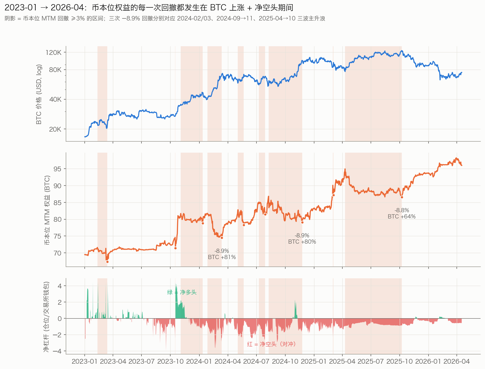
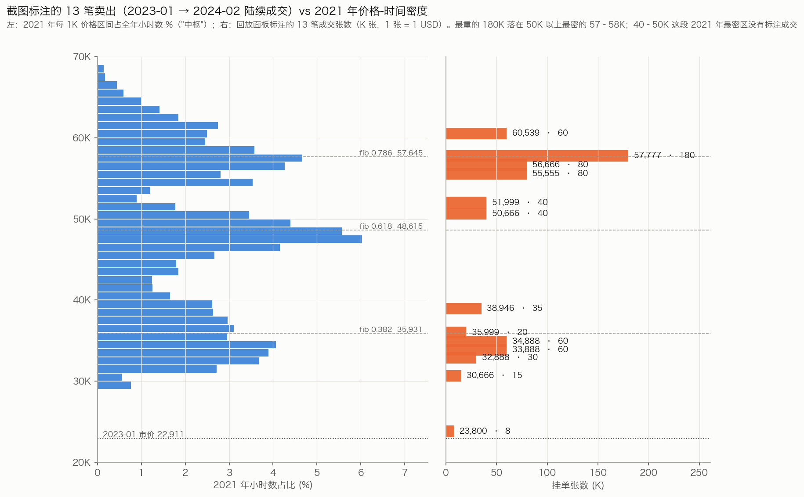
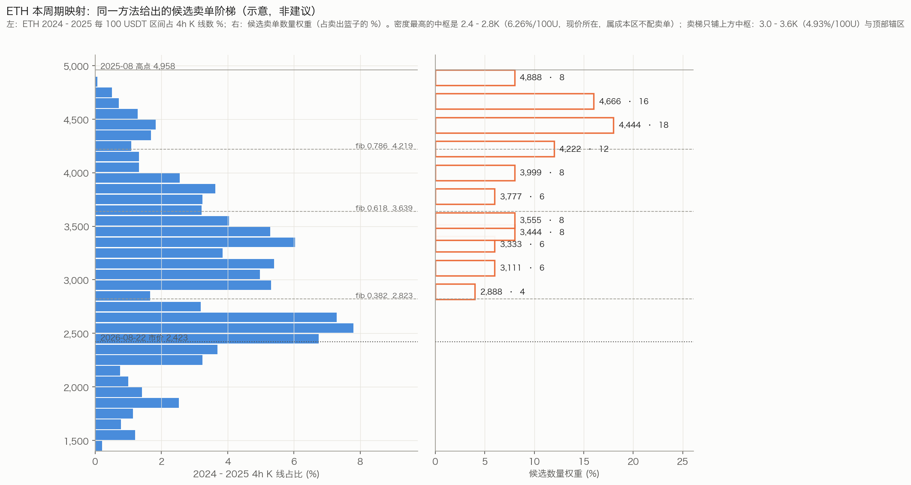
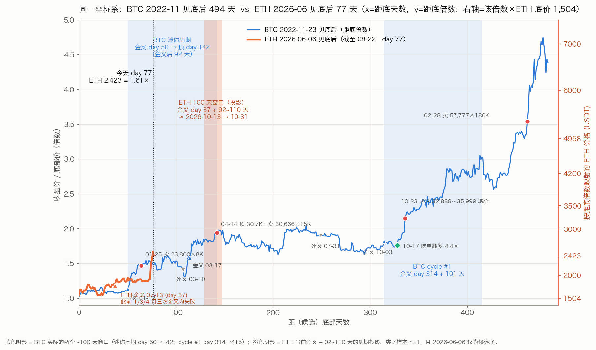

# 魏神阶梯复盘

*An independent review of Paul Wei's ([@coolish](https://x.com/coolish)) public BitMEX ledger: sell-ladder geometry, coin-denominated drawdowns, three years of leverage evolution, and a mapping onto an ETH coin-margined strategy. Written in Chinese.*

基于 Paul Wei（[@coolish](https://x.com/coolish)，魏神）**公开的 BitMEX 原始账本**所做的独立复盘。只看原始挂单、成交与钱包流水，不看任何策略代码，回答三个问题：

1. 他的卖单阶梯到底按什么几何铺设、是不是真的"提前一整个周期挂好"；
2. 2023 年起这轮牛市里，他的币本位为什么涨了又回撤、回撤从哪来；
3. 把这套打法搬到 ETH 币本位时，哪些错可以不再犯。

> **独立分析，与 Paul Wei 本人无任何关联。不构成投资建议。**

## 阅读

完整报告是一个静态页面：克隆后用浏览器打开 [`index.html`](index.html)（随系统切换浅色 / 深色主题）。

## 目录

| 章节 | 内容 |
|---|---|
| 00 · 结论 | 先说五件事 |
| 01 · 数据与口径 | 用了什么、怎么重建、哪里不能信 |
| 02 · 阶梯几何 | 他到底怎么提前挂的 |
| 03 · 2023 年起的上涨 | 币本位为什么涨了又回撤 |
| 04 · 他的错 | 按代价排序，每一条对应一个可写进规则的教训 |
| 05 · 回撤控制 | 从他的数据里直接读出来的六条规则 |
| 06 · ETH 映射 | 同一方法，这一轮该怎么提前铺 |
| 07 · 阶段参数 | 底部阶段他做了什么、突破那天做了什么 |
| 08 · 时间对齐 | BTC 2023-01 vs ETH 2026：100 天窗口与决策脚本 |
| 09 · 错误驱动的策略修正 | 2023-01 → 04 他错在哪，ETH 怎么改 |
| 10 · 对冲视角 | 净空不是做空：卖梯子 = 加对冲，对冲比例由价格位置决定 |
| 11 · 真实挂法还原 | 2023 年 1–4 月逐笔还原的下单形态 |
| 12 · 三年杠杆 & 2023 双百日对照 | 2023 会赌、2024 常驻对冲、2025 纯对冲 |
| 13 · URPD vs 时间密度 | 链上筹码与价格停留时长为何给出不同答案、信谁 |
| 14 · 归因 | 频率下降是降敞口还是优化模型 |
| 15 · 2023 行为拆解 | 钱从哪三件事来、被哪三件事拿走、哪些白忙 |

## 图表

**币本位权益的每一次回撤，都发生在 BTC 上涨 + 净空头期间（2023-01 → 2026-04）**

**卖单阶梯 vs 上一轮（2021）价格-时间密度**

**ETH 本周期映射：同一方法给出的候选卖单阶梯（示意）**

**BTC 2022-11 见底后 vs ETH 2026-06 见底后：100 天窗口对齐**

## 数据与方法

- **账本**：[bwjoke/BTC-Trading-Since-2020](https://github.com/bwjoke/BTC-Trading-Since-2020)，Paul Wei 账户 2020-05 → 2026-04 的公开镜像（43,214 条委托、173,058 条成交、钱包流水）。本仓库**只包含派生统计与图表，不再分发原始数据**。
- **行情**：BitMEX XBTUSD 1h / 1d；ETH 行情来自 OKX。链上筹码分布参考 Glassnode URPD；BMNR 持仓来自其公开披露。
- **仓位重建**：按反向合约口径（1/价格加权均价）从成交流水逐笔重建 XBTUSD 净仓位；期末 −1,298,000 张、均价 73,013.5，与交易所终端快照逐张吻合。
- **已知口径限制**：`transactTime` 自 2024 年起等于成交/撤单时间而非下单时间；BitMEX 每日 12:00 UTC 结算已实现盈亏，单日归因会有 ±1 天涂抹（报告改用多日事件窗）。详见报告 §01 与 §15。

## 免责声明

本文是对公开账本的统计描述与模型参数推导，不是投资建议；文中价位与阶梯均为方法演示，不构成任何买卖推荐。对交易行为的评价仅基于公开数据的事后统计，不代表当事人的真实意图。
